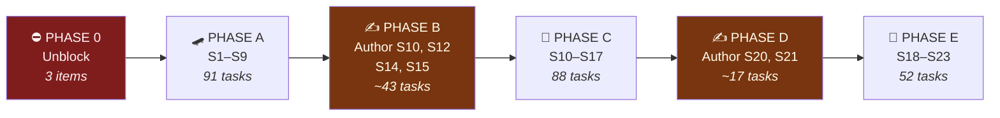

# PLAN — what to do, in what order

> **Completion tracking moved to [SLICES.md](SLICES.md).** This document preserves historical planning and evidence. Its progress claims may be stale. Update task Notes and SLICES.md for new work; do not mirror completion here.

**The execution plan.** [`TASKS.md`](TASKS.md) lists every task; this says what has to happen *around* them
and in what sequence, including what must be true before a single slice is seeded.

| | |
| --- | --- |
| **The picture** | [`VISION.md`](VISION.md) |
| **The contract** | [`ROADMAP.md`](ROADMAP.md) |
| **Every task, in order** | [`TASKS.md`](TASKS.md) |
| **How to seed a slice** | [`SEEDING.md`](SEEDING.md) |



**Phase B is the one people will forget.** Four slices in the car stage have no task files, and S10 gates
every one after it. Authoring them is work that must be scheduled, not discovered.

---

## Dependency map — what can run in parallel

**Three states, not two** — this plan's own rule for an unknown (P31) applies to scheduling as much as to a
cost. For any pair of slices, this plan either **states they're independent**, **states an order**, or **has
not examined the question** — and the third state is not "probably fine, go ahead." It means check before
dispatching two agents into it.

### Confirmed independent — dispatch concurrently

| Slices | Why | Stated where |
| --- | --- | --- |
| **S6, S7, S8** | suspend, recovery and blueprints touch disjoint parts of S4's schema | Phase A, below |
| **S10/S12/S14/S15 authoring** ∥ **S1–S9 build** | writing task specs is not Go; it does not contend with the build | Phase B, below |
| **S20/S21 authoring** ∥ **S10–S17 build** | same reason, one stage later | Phase D, below |
| **S18, S22, S23** | providers, retrieval and first-run touch disjoint surfaces | Phase E, below |
| **S24 build ∥ S11 onward** | needs S1–S10, S8, S9 (all built), and explicitly *not* S16 — T1–T4 and T6–T9 need nothing past S10; **T5 (sizing) alone also needs S13's handler registry, now built too** | [`S24-loop-queue/design.md`](S24-loop-queue/design.md) |
| **S25 build ∥ S11 onward** | needs only S4 and S9 (both built) — read-only, no new table, ever. The archive tables D7's merge reads are S4's own (migration `0004`), not S17 — a dependency the sketch's own phrasing would have implied wrongly | [`S25-history/design.md`](S25-history/design.md) |
| **S28 learnings core (T1–T6, T8 — all three scopes, including agent) ∥ S11 onward** | needs S4, S9 and S13 (all built — S13 matters now that agent scope is in this tier, not a separate wait) — not S10, S11, S12, S15–S27, and explicitly not S22 (D7's corpus-boundary decision). **T7 (the message board) is the one piece still waiting**, on S14 | [`S28-memory/design.md`](S28-memory/design.md) |
| **S30 build ∥ S11 onward** | needs only S4 and S9, both already built — not S10–S29, and explicitly not S22's corpora or S20's trigger mechanism (both considered and ruled out while writing the brief) | [`S30-code-graph/brief.md`](S30-code-graph/brief.md) |

**S24, S25, S28's learnings core, and S30 are the four worth acting on, not filing away.** Stage 3 (S11–S17)
and Stage 4 (S18–S23) are 141 of this plan's 233 tasks — none of the four needs any of them for its core
mechanics. All four dependency sets (S1–S10 plus S8 and S9) are **already built** (STATUS.md's progress
bar: S1–S10 all ✅, 2026-10-21), and by 2026-10-26 so is S13 — which matters for two of the four, not just
one: **S24's own `design.md` needed it** (T5, sizing, dispatches through S13's handler registry), and **so
does S28's** — agent-scoped learning, previously tracked as a separate wait (below), turned out to need
exactly S13 too, now built, so it folded into the same free-to-start tier as person/project scope rather
than staying a second dependency gate. Agents could start on S24, S25, S28's learnings core (all three
scopes) or S30 today, in parallel with whoever is on S11 and with each other, without any of them waiting on
the others — each touches a disjoint part of the system (S24 orchestrates existing loop-start/attendedness
machinery; S25 adds one new read-only package over existing tables; S28's learnings core adds `internal/
learnings` and a query path over it; S30 adds two new tables and a parser nothing else calls; S11 builds the
permission evaluator none of them calls). **S24, S25 and S30 are all closer to seedable than S28's learnings
core** — all three now have `design.md`, `plan.md` and task files of their own, not only a brief — though
**S28 now has exactly the same depth too**: `design.md`, `plan.md` and 8 task files, 6 of them (plus half of
the 8th) buildable in this same free tier, only T7 genuinely still waiting.

**S33 Telemetry is a fifth candidate, but not yet in this "free to start" bucket.** Unlike the four above,
it edits the live step runtime directly (`internal/runtime/{compact,runstep,loop}.go`) rather than adding a
disjoint package — **S31 (Loop workspace) is now built, and the collision is confirmed, not hypothetical**:
its own T4 already edits `internal/runtime/loop.go`'s `RunLoop` for steer injection (S33's own brief, R1,
updated 2026-10-26). It has a brief only; `design.md`/`plan.md` are the next pass, and that pass's first
job is the same `files_expected` collision check S24's seeding used against S11.

**S34 Trust bench is the sixth candidate, and unlike S33 it is authored to plan depth.** Designed
2026-10-26 as the first slice under **P34** (the daemon surface is the primary interface, the CLI
secondary), and its task order encodes that doctrine: four new daemon read methods (`agent.list`,
`tools.grants`, `mcp.status`, `mcp.check`) are the deliverable and the two bench pages are thin clients of
them (T1–T4 complete before T6/T7 render a fact). Every dependency it names — S4, S9, S11, S12, S13 — is
**built code**, so unlike S33 it edits no live runtime and has no unbuilt wait; its collision surface is the
shared `protocol/method.go` table and dispatcher (its brief's §8 R2), so seeding runs the same
`files_expected` check against whatever daemon-read slice is in flight. [`S34-trust-bench/brief.md`](S34-trust-bench/brief.md)
· [`design.md`](S34-trust-bench/design.md) · [`plan.md`](S34-trust-bench/plan.md).

**S35 Trust desk is the seventh candidate — S34's sequel and P34's second child.** Designed 2026-10-26 to
resolve the one collision P34 creates with a standing ruling: *every capability needs a daemon door* vs
*policy authoring gets no socket door* (PL15/R4/R6, enforced by
`TestNoPolicyAuthoringReachesTheNarrowSurface`, `cmd/aeon/policy_test.go:483`). The peace is the one P34
itself pre-named — **inert proposals on the socket, commit through a human-only door**: agent
enable/disable/revoke become plain socket writes (riding `TransitionPluginAgent` verbatim, so a
reasonless revoke stays un-writable through the new door too), while everything that widens authority —
policy add/remove/seed, grants (*grants are policy*, S12), MCP server add/remove — becomes a row in one new
`proposal` table the guard's read paths must never read, and **no commit button exists in the app in any
form**, pinned by grep. Nine tasks, **strictly sequential** (the operator's 2026-10-26 no-parallel
directive); one new table, one new config writer, **zero new validation logic** — creates and commits run
the same validators the CLI verbs already run. It is *not* free-to-start like the five above: its bench tier
edits S34's pages, so it seeds **after S34's daemon tier** (T1–T4) lands.
[`S35-trust-desk/brief.md`](S35-trust-desk/brief.md) · [`design.md`](S35-trust-desk/design.md) ·
[`plan.md`](S35-trust-desk/plan.md).

**S36 MCP dispatch — built 2026-10-30 (T1–T6 ✅) — is the trust trio's load-bearing member: S34 sees it · S35
authorizes it · S36 runs it.** Designed 2026-10-26 as P34's third child: the slice where an MCP tool a
human added (S35), checked (S34) and granted (S11) finally *executes inside a loop step*. The gate is
**double** by ruling: the agent must *see* the server (S12's tier map — private nested, public declared)
**and** a `ToolAccess` allow row must name the exact qualified `server.tool` — **no row, never runs**;
`ask` (by row or S12's own L22 effect rule) parks on the existing `pendingPermission` path, and a dead
server **degrades, never hangs, never promises**. The architecture turned on one discovery:
`absent_test.go`'s banned list *names `internal/daemon`*, so the first sketch's "adapter in daemon + dated
grep amendment" died — instead the adapter is a **function value in `daemon.Options` implemented in
`cmd/aeon`**, the sanctioned importer: a function value carries no import, `internal/daemon` stays
MCP-blind, and MC11's test survives with **zero diff lines**. The offer *calls* S12's `GrantView` (zero
new verdict logic; MC10's sentence stays single-defined across CLI, view and runtime), enters through
the one choke point (`BuildTools`), and is deleted in one commit — three files and a wiring line. Six
tasks, **strictly sequential**; zero socket methods, zero pages — and the S34 §5 latent MC11 collision
(daemon calling `mcp.Probe` directly) was found and amended in passing. Unlike S35, **free to start**:
every dependency is built code.
[`S36-mcp-dispatch/brief.md`](S36-mcp-dispatch/brief.md) · [`design.md`](S36-mcp-dispatch/design.md) ·
[`plan.md`](S36-mcp-dispatch/plan.md).

**S37 Agent admission is the ninth candidate — the trust trio's fourth member, closing the one gap S35 named
and left open on purpose.** S35's own brief treats import as a precondition (*"the imported agent already
passed blocklist + consent at import (S15)"*); S37 makes it a staged proposal — one new `kind`
(`agent_import`) in S35's existing enum, not a new mechanism. The payload is a bare `pkgPath` (the smallest
of any kind); the daemon re-reads the package at `proposal.create` (a preview, refusing early on the real
validator's reason) and at `aeon proposal commit` (the actual import, through `ImportChecked` unchanged —
the identical function `aeon agent import` already calls). The one genuinely new risk S35's other four
kinds lack: the filesystem can move between propose and commit, so a commit that now refuses sets
`applied_error` and stays `proposed`, never flipping on a stale preview. Seven tasks T1–T7 + T0
investigation, **strictly sequential**; one new export (`readPackage`→`ReadPackagePreview`, a rename), zero
new socket methods, zero new bench pages. **Built** on branch `s37-agent-admission`, merging to main;
seeds after S35's T1–T5.
[`S37-agent-admission/brief.md`](S37-agent-admission/brief.md) · [`design.md`](S37-agent-admission/design.md) ·
[`plan.md`](S37-agent-admission/plan.md).

**S28's one remaining piece is not this free.** The message-board half (T7) needs S14 (A2A skill invocation)
— the agent-scoped-learning wait this paragraph used to describe is gone, folded into the free tier above
now that S13 is built. **S29 Triage is now in the same state as S28**: `design.md`, `plan.md` and 9 task
files exist, and five of them (T1–T4, T7–T8) need only S4, S5 and S13 — all built, a free tier of their own.
Its other two tasks each carry a real-code dependency rather than an unbuilt-slice one: **T5** needs
`S28-memory`'s own learnings core as real code, **T6** needs `S26-roadmap`'s core (which itself needs
S24/S25 built). Both S28's T7 and S29's T5/T6 appear in the ordered table below.

### Confirmed ordered — do not parallelize

| First | Then | Why | Stated where |
| --- | --- | --- | --- |
| S1 | everything | nothing else builds without it | Phase A |
| S3 | S4 | the store persists canonical messages; their shape settles first | Phase A |
| S4 | S5 | nothing to build a runtime against until the tables exist | Phase A |
| S19 | S20 | a webhook endpoint is a projection on the narrow surface, not a second listener | Phase E |
| S19, S14 | S21 | remote A2A needs both the narrow surface and agent services | Phase E |
| S4, S9 | S25 | History reads the store and renders per project; nothing else it needs | [`S25-history/design.md`](S25-history/design.md) |
| S4, S13, S9, S14 | S28 T7 (message-board half) | a directed question is S14's A2A skill invocation; nothing to invoke before S14 exists. T1–T6 and T8's learnings half need none of this — S13 is already built, folded into the free tier above | [`S28-memory/design.md`](S28-memory/design.md) |
| S4, S5, S13 | S29 T1–T4, T7–T8 | a validation attempt is an ordinary S5 loop; S13 supplies who runs it. All three already built — this half has no real wait left | [`S29-triage/design.md`](S29-triage/design.md) |
| S29 T2, `S28-memory` T1/T2 | S29 T5 | the learning-feed hook (D10) calls `internal/learnings.Append` directly; nothing to call until S28's learnings core is real code, not just a design | [`S29-triage/design.md`](S29-triage/design.md) |
| S29 T2, `S26-roadmap` T1/T2 | S29 T6 | the hand-off (D8) calls `internal/roadmap`'s `Create` directly; S26's own core needs S24/S25 built first, so this is the deepest chain in this plan | [`S29-triage/design.md`](S29-triage/design.md) |
| S8, S9, S24, S25 | S26 | the roadmap renders S24's ordering and S25's record; it builds neither — **but unlike S24/S25/S30, this is a real code dependency, not just a documented one**: T4 calls `internal/queue.Append` and T6 imports S25's Gantt component directly, so S26 cannot actually be built until S24 and S25 are, even though all three are now equally "specced to task files." **S29's T6 optionally feeds it too** (a triaged bug becomes a roadmap item, `provenance: 'triaged'`) but S26 does not need S29 to exist | [`S26-roadmap/design.md`](S26-roadmap/design.md) |
| S8, S11, S16, S24, S26 | S27 | continuous work generalizes S24's advance-on-done past one project — now a real `brief.md`, kept to brief depth deliberately (its own sketch called it "the largest change to the daemon's model in the whole plan") | [`S27-continuous/brief.md`](S27-continuous/brief.md) |

### Stage 3 (S10–S17), from each slice's own header — not the roadmap's prose chain

**The "S10 → S11 → S12 → S13 → S14 → S15 → S16 → S17" chain in Phase C below is a narrative, not the graph.**
Reading each slice's own `brief.md` header gives a different, more branched answer — and the two documents
disagree on one edge:

| Slice | Depends on (its own brief) | Blocks (its own brief) |
| --- | --- | --- |
| **S10** | S1–S9 | S11–S15 |
| **S11** | S1–S9 *(S10 is not listed, but this plan's Phase C forces S10 first regardless)* | S13 |
| **S12** | S10, S11 | **S13**–S15 |
| **S13** | S8, S11, **and S12** — amended 2026-10-22; its header previously omitted S12 | S16, S17 |
| **S14** | S10, S12, S13 | S15, S21 |
| **S15** | S10, S12, S14 | — (S21 extends it over the wire) |
| **S16** | **S8, S11, S13 only** — not S10, S12, S14 or S15 | S17 |
| **S17** | **S8, S11, S13, S16 only** — not S10, S12, S14 or S15 either | — |

**The flagged disagreement:** S12's brief says it blocks S13; S13's brief, until this fix, did not list S12
at all. `ROADMAP.md` §7 explains why — N17's reversal moved S12 ahead of S13 because 24 of 26 agent bodies
reference MCP as a real granted tool rather than deferred-because-absent content — and marks that amendment
**open**, meaning decided but never applied to S13's own header. Fixed in `S13-agents/brief.md`; **S13's D4c
still needs re-reading against S12's real tool set before this slice is planned**, which the header fix does
not resolve on its own.

**What this actually means for parallel work:**

- **S12 and S13 — no.** Confirmed blocking, not independent (the point above).
- **S16 and S14, or S16 and S15 — yes, once S13 is done.** S16's own header needs only S8, S11, S13; neither
  it nor S14/S15 names the other. Git/forge does not need agent services or plugins to exist.
- **S17 and S14, or S17 and S15 — yes, once S16 is done.** Same reasoning — S17's header needs S8, S11, S13,
  S16, and nothing else.

### Not yet examined — default to numeric order

Everything else: in particular S2 against S3/S4, S9 against S6–S8, and the task-level order *inside* S18,
S22 and S23 beyond "the three slices don't block each other." [`TASKS.md`](TASKS.md) gives numeric order for
all of these; nobody has reasoned a finer-grained answer, so none is claimed here. S24, S25, S28 and S29 are
no longer in this bucket — their briefs now state real dependencies, carried in the tables above.

---

## Phase 0 — three things, before any slice is seeded

### P0.1 · Resolve the MCP version pin ✅ **DONE 2026-10-14**

`opencode/opencode.json` pins `@cjlapao/loop-state-mcp@0.1.6`. npm has `0.5.2`. The local build is `0.6.0`.

**0.1.6 cannot seed a loop.** Verified by downloading it from npm and reading its tool table — **19 tools,
and `loop_writeFile` is not among them.** Neither is `loop_readFile` or `loop_readTask`.

| | |
| --- | --- |
| `loop_writeFile` **absent** | `SEEDING.md` steps **2, 3, 4 and 5** all call it — the prompt, the discovery, the plan, and every task file |
| `loop_readTask` **absent** | how an engineer reads the task it was dispatched to |
| `loop_readFile` **absent** | how any agent reads `plan.md` or `discovery.md` |

And a document cannot reach the store any other way — `SEEDING.md` is explicit that *"copying `plan.md`
into a loop directory does not seed a loop"*, because loop documents live in the store and the mirror is
disposable.

**So four of the ten seeding steps call a tool that does not exist.** This is not a missing fix; it is the
difference between starting and not starting.

**Do:** publish `0.6.0` and update the pin, or point the config at the local build
(`["node", "packages/loop-state-mcp/build/index.js"]`) while the MCP is still changing. 0.6.0 has **39
tools and drops none of 0.1.6's**, so nothing is lost by moving.

**Still worth checking why `0.1.6` was pinned** — if that was a deliberate known-good pin rather than
drift, understand what moved before trusting four minor versions of change.

**Done when:** a loop tool call lists `loop_writeFile`, and a throwaway `loop_init` + `loop_writeFile`
round-trips.

> **Landed.** `0.6.0` published and the pin moved. Verified by downloading the published tarball:
> **39 tools, and all nine the seeding sequence needs are present** — `loop_writeFile`, `loop_readFile`,
> `loop_readTask`, `loop_appendFile`, `loop_init`, `tasks_derive`, `loop_setPhase`, `loop_setPhaseStatus`,
> `loop_setAwaitingUser`. Nothing 0.1.6 had was dropped. One line changed in `opencode/opencode.json`.

### P0.2 · Give 111 tasks an `engineer` and a `tech` ✅ **DONE 2026-10-14**

`tasks_derive` requires both on every task (`engineer: z.string()`, `tech: z.string()` — neither optional).
S1–S6's 60 tasks have them; **S7–S23's 111 do not.**

**Do:** add both fields to the frontmatter of those 111 files. [`TASKS.md`](TASKS.md) already carries the
inferred value for each, marked `*`. **Review S9 and S23 by hand** — S9 spans Rust and TypeScript, S23 is
mostly docs, and those are the two slices where inference from `files_expected` is weakest.

**Why not just let the orchestrator infer:** it can, and the inference is good. But A13 closed the handler
registry *with no fallback* precisely because "a generic handler writing Elixir produces something
plausible, the loop reports `ok`, and the badness surfaces three steps later attributed to the model."
**Dispatching a Rust task to a Go engineer is that same failure**, and it is cheaper to write 111 fields
than to debug it once.

**Done when:** every task file has `engineer:` and `tech:`, and a dry-run `tasks_derive` on one S7+ slice
is accepted.

> **Landed.** All 171 tasks now carry both fields; the 111 were derived from each task's `files_expected`
> and the frontmatter re-parses clean. **Validated against the real `DeriveSchema` from the published
> 0.6.0 — all 17 slices accepted.** Every `engineer` value resolves to an agent that exists in
> `opencode/agents/`.
>
> **Three judgement calls, each a correction rather than a transcription:**
>
> | | |
> | --- | --- |
> | **S9 T2 → `go`** | Its deliverable is `aeon/tools/protogen/main.go` and a Go test. The `.ts` files in `files_expected` are the generator's **output**, not hand-written — classifying on the extension would have sent a Go codegen task to a React engineer |
> | **S9 T1, T3 → `tauri-react`** | They span `ui/src/` **and** `ui/src-tauri/*.rs`. `tauri-react-engineer-loop` exists precisely for "the React/TS frontend, the Rust command/IPC layer, and Tauri v2 config" — a generic `rust-engineer-loop` would not know Tauri's IPC |
> | **S1 T5, S2 T7 → `tauri-react`** | **These were already assigned**, to `react-typescript-engineer-loop`, and both build the Rust shell. Left alone, two tasks would have dispatched Rust work to a React-only agent — which is exactly A13's failure: *plausible output, `ok` reported, badness surfacing later attributed to the model* |
>
> **Final distribution:** 143 `golang-engineer-loop` · 16 `technical-writer-loop` · 8
> `react-typescript-engineer-loop` · 4 `tauri-react-engineer-loop`.

### P0.3 · Commit the ground floor 🟡 **the only thing between here and S2**

`aeon/` is untracked — now ~30 files including `ui/`, `.vscode/` and `docs/BUILD.md`. `make ci` green,
41 Go tests + 9 UI tests, and S1's demo and test spec both walked.

**Do:** commit it with the S1 doc updates as one reviewable baseline.

```bash
git add -A                 # the complete tree; never hand-picked
git commit                 # message: "S1: the ground floor"
```

**Why it blocks S2 rather than being tidiness:** the first loop runs `git add -A`. Uncommitted, the ground
floor is swept into the agent's own first commit and stops being a diffable starting point — so the first
thing anyone reviews is 30 files of scaffolding mixed with the work they meant to review.

---

## Phase A — S1 through S9 · 91 tasks · nothing missing from the framework

**Everything these nine slices need is present in `framework/v0.10.1`.** Verified, not assumed:

| Need | Slice | What satisfies it |
| --- | :--: | --- |
| Local JSON-RPC endpoint | S2 | `framework/localrpc` — `Register`, `Notify`, `Connections`, `EndpointPath` |
| SQLite, its config, its pool | S4 | `framework/database` + `SQLiteConfig{StoragePath,FileName,DSN}` + `PoolConfig` |
| `sqlite-vec` on that connection | S4 | `gorm.io/driver/sqlite` → `mattn/go-sqlite3`; **`sqlite_vec.Auto()` proven to work through GORM** |
| Raw `*sql.DB` for direct SQL | S4 | `(*gorm.DB).DB()` |
| YAML | S8 | `gopkg.in/yaml.v3` — **already in the tree; do not add a second** |
| Retry / backoff | S3 | `cenkalti/backoff/v4` |
| The desktop UI toolkit | S1 T5 · S9 | **`@cjlapao/ui-kit@^0.2.0`** — see Phase A′ |

**Aeon's by design, not gaps:** the provider HTTP client and SSE streaming (S3 owns the canonical
transport), and everything above the database connection.

**Order:** exactly [`TASKS.md`](TASKS.md). Three orderings are load-bearing — **S3 before S4** (the store
persists canonical messages, so their shape settles first), **S4 before S5** (nothing to build a runtime
against until the tables exist), and **S6/S7 and S8 may run concurrently in separate worktrees.**

**The gate for this phase is S9's demo**: start a loop from the app, watch the ladder fill in live, answer a
question inline, pull the socket out and watch the UI go honest.

---

## Phase A′ — the UI kit, which changes two task specs

**`@cjlapao/ui-kit@0.2.0` is the toolkit, and it is not a new decision** — v1's `packages/loop-state-ui`
already depends on `^0.2.0`, so S9's *"port the components from v1"* was always going to port components
built on it. **What is new is that neither S1 T5 nor S9 says so.** Both are amended.

### What it already covers

~200 components, and the ones that matter here map almost exactly onto S9's screens:

| S9 needs | ui-kit gives |
| --- | --- |
| The app shell | `SideMenuLayout` · `SideMenu` · `SplitView` · `Panel` · `Tabs` |
| The ladder | `Stepper` · `useStepper` · `StepperState` — **with a gap, below** |
| The thread | `TimelinePanel` · `TimelinePanelItem` |
| Cost, three states | `StatTile` · `StatCountTile` · `Pill` · `Alert` |
| Blueprint shape | `TreeView` · `TreeItemCard` · `ConnectionFlow` · `TreeFlowSvg` |
| Transcripts | `./markdown` subpath · `TruncatedText` · `Table` |
| Theming | `useTheme` · `ThemeMode` · `configureTheme` |

### Two gaps, and they are exactly where S9's thesis lives

> **These are the renderings S9 exists to get right, and the ui-kit cannot express either one yet.**

**1 · `StepStatus` cannot express the ladder.** It is
`"pending" | "active" | "completed" | "error"`. **D13 requires `not-needed`, `skipped` and `pending` to
render *distinctly*, and a bypassed lane to show its condition.** Two states missing, and the easy mistake
is mapping `not-needed` onto `completed` — which tells a reader the lane ran.

**2 · There is no liveness three-state.** `ConnectionState` is `"flowing" | "stopped" | "disabled"` and
belongs to `ConnectionFlow` diagrams, not to socket liveness. S9 needs **`current` / `stale, with an age` /
`reconnecting`**, and D7 forbids the stream reconciling by `seq` on reconnect — it must re-read.

**Decide per gap:** extend the ui-kit upstream (it is ours, and both additions are general), or compose
locally in `aeon/ui/src/components/`. **Extending is better if another product wants a ladder; composing is
faster.** Either way, **do not reach for the closest existing type** — that is how `unknown` becomes `—`
and `—` becomes `0`.

### The mechanical requirements

- **peer deps are not optional:** `react ^18 || ^19.1`, `react-dom`, **`react-router-dom ^6 || ^7`**. The
  router is a peer even if the app has one window.
- **`import "@cjlapao/ui-kit/styles.css"`** once, at the entry. Prebuilt **Tailwind v4.3.3**, so the app's
  own Tailwind 4 config must not fight it.
- **Bundle size is real**: `index.cjs` ~1.2 MB, `index.css` ~653 KB. Fine for a desktop app, worth knowing
  before it is a surprise. Tree-shaking works through the ESM `module` entry.
- **One markdown renderer, not two.** v1 uses `react-markdown` + `remark-gfm`; the kit ships `./markdown`
  on `@uiw/react-md-editor`. **Pick one.** Two markdown stacks in one bundle is the same reasoning S8's Q6
  applies to YAML.

### The amendments

| Where | Change |
| --- | --- |
| **S1 T5** | The stack is Vite 7 · React 19 · **`@cjlapao/ui-kit@^0.2.0`** · `react-router-dom` · Tailwind 4 · TS 5.6. The skeleton window renders a ui-kit component, so the integration is proven at seven tasks rather than at eighty |
| **S9 T5** (the port) | *"Port the components"* means **port components already built on the kit** — v1's `LoopCard`, `TaskSteps` and the rest import from it today. Port the composition, not a reimplementation |
| **S9 T4** (three-state renderers) | **Resolve both gaps above before writing the renderers**, and record which way each went |

---

## Phase B — ✅ DONE 2026-10-14 · the four car-stage slices are authored

**All four are authored and seedable: S10 Policy (12), S12 MCP client (10), S14 Agent services (12),
S15 Agent plugins (9) — 43 tasks, every one accepted by the real `DeriveSchema`.**

> **S10, S12, S14 and S15 are authored — ✅ 2026-10-14.** 43 tasks across the four. S14 carries **A1's
> amendment**: still nothing spawns, and the delegation chain is recorded so cost rolls up along it.
>
> **Earlier detail —** S10: 15 PL decisions, 12 tasks.
> S12: 12 MC decisions, 10 tasks, including the `W23` amendment extending untrusted labelling to tool
> *descriptions* — the largest thing runtime tool extension costs.
>
> **S10 detail —** `design.md` (15 PL decisions), `brief.md` (16 DoD items),
> `plan.md`, `DEMO.md` (8 sections) and **12 task files**, all accepted by the real `DeriveSchema`. Its
> dependency graph is acyclic and numeric order is execution order. **S10 is seedable.**

**Order, and it is forced:** **S10 first — done.** It gates S11 through S15, and `CommandAccess` is the
shape the 366-rule corpus has to fit. **Phase B is complete. Phase D (S20, S21) is the remaining authoring.** — which is the dependency order
anyway.

**Do this during Phase A, not after.** It is specification work, not Go, so it does not contend with the
build — and S9 finishing with S10 unwritten stalls the whole car stage.

**Done when:** each has `design.md`, `brief.md`, `plan.md`, `tasks/T*.md` with `engineer`/`tech` present,
and a `DEMO.md`.

---

## Phase C — S10 through S17 · 88 tasks · the car

**The chain is the security model:**

```
S10 policy → S11 permissions → S12 tools → S13 agents → S14 services → S15 plugins
```

**Each layer can only narrow what the one above it granted.** Build one out of order and it has nothing to
narrow. Then S16 git/forge, then **S17 — the first slice where the whole protocol runs end to end.**

**Two amendments already landed that this phase must honour:** S4's `T2` created the three policy tables, so
S10 adds the evaluator rather than a migration; and S11's `W21` was rescoped — the nine become the *core*
nine, extended at runtime in S12, never in S11.

**One open amendment to settle early:** **S13's `DEFERRED` treatment of MCP content.** 24 of 26 agent bodies
reference MCP, and S12 now *precedes* S13 — so that content is no longer deferred-because-absent, it is a
granted tool. Decide when S12 lands, not when S13 starts.

**The gate is S17's demo:** a real feature, specified as a task, built by Aeon, **with a deliberate defect a
downstream lane catches and sends back**, reviewed, and merged.

---

## Phase D — ✅ DONE 2026-10-14 · the two shuttle slices are authored

**Both are authored and seedable: S20 Triggers (9) and S21 Remote agents (9).**

> **All 23 slices now have task files — 232 tasks, every one accepted by the real `DeriveSchema`.**
> Authoring is complete; what remains is building.

**S20 carries the one framework finding worth acting on.** `framework/jobs` is the obvious home for a
schedule and **cannot be used: it hard-depends on `redis`** (`Deps("config","logging","redis")`,
asynq-backed). *"Install Redis to schedule a 3am job"* breaks the one-install promise.

**`robfig/cron/v3` is already in the dependency tree** via that same service, so **S20 uses the library and
not the service.** Nothing to request upstream — but write the reason down, because the next person will
also notice `jobs` and wonder.

---

## Phase E — S18 through S23 · 52 tasks · reach

**S18, S22 and S23 are independent of each other** — order them by what you need first. **S20 needs S19**
(a webhook endpoint is an enumerated projection on the narrow surface, not a second listener). **S21 needs
S19 and S14.**

**S19's scope already shrank:** `framework/api` is a registerable HTTP server as of v0.10.1, so S19 does not
build one. It is registered today and **`ForceOff`-pinned**; S19 removes the pin and adds the explicit bind
address, the required key, and the action table.

**The gate is S23's demo**, and it is the only Definition of Done in the plan a machine cannot evaluate: a
stranger on a clean machine, holding one API key, reaches a running loop in **under five minutes** — timed,
by someone who has not read the design.

---

## What is NOT in this plan

- **Stage 5** — no slice is a bare sketch left unexamined anymore. **S27 continuous** is the only one that
  stayed at brief depth, deliberately, asked explicitly, since its own sketch called itself "the largest
  change to the daemon's model in the whole plan." At write time it sat on S16/S24/S26, none built; **S16
  is now built (2026-10-26)**, leaving S24/S26. **S24 queue, S25 history, S26 roadmap, S28 memory, S29
  triage and S30 code graph go further still**: `design.md`, `plan.md` and task files (nine, six, seven,
  eight, nine and eight respectively), not only a brief — though two of the six still carry a real
  asterisk: **S26 cannot actually be built yet**, since its own code depends on S24's and S25's (above),
  and **S27 depends on S26 in turn**, so it sits one layer further out still; **S29's T5 and T6 each need a
  sibling slice's real code** (S28's learnings core, S26's core respectively) while its other seven tasks
  are free. **S28 lost its own asterisk 2026-10-26** — S14 landed, T6/T7 re-checked against its real API,
  all 8 tasks now buildable. **S33 telemetry is brief-only** but newly added, not a promoted sketch;
  **S34 trust bench is the second new addition** (2026-10-26, the first slice written under P34), authored
  to `brief.md`/`design.md`/`plan.md` depth — eight tasks, every dependency already built code.
  **S35 trust desk is the third** (same day): S34's sequel, nine tasks at the same depth, strictly
  sequential by operator ruling, and the first slice to *reconcile* P34 with a standing ruling instead of
  just extending it — its `proposal` table is the peace between "everything gets a daemon door" and
  "policy authoring gets no socket door".
  **S36 mcp dispatch is the fourth** (same day again): the trust trio's load-bearing member — six tasks,
  same depth, strictly sequential — where a granted MCP tool finally executes inside a step, through a
  function seam that keeps `internal/mcp` MC11-deletable with **zero diff lines** in its guard test; it
  retro-fixed S34's design §5 in passing (the daemon had been about to import the layer directly).
  **None of these eleven is in this plan's phases above**; seeding any of them is a decision for whoever
  picks it up, not an implicit Phase F.
- **Activating CI.** The workflows are parked in `aeon/.github/workflows/` until Aeon moves to its own
  repository. That move is the trigger, and `.github/workflows/README.md` owns the procedure.
- **Six-target cross-compilation.** S1 T4's, and **measured at 1 of 6** once a real cgo dependency is in the
  tree. The six-target CI job is non-blocking until it closes.

---

## The one-screen version

| # | Do | Blocks |
| :--: | --- | --- |
| **0.1** | Resolve the MCP pin → `0.6.0` | everything |
| **0.2** | `engineer`/`tech` on 111 tasks | every slice from S7 |
| **0.3** | Commit `aeon/` | a clean first diff |
| **A** | **Seed S1. Then S2…S9 in order** | — |
| **A′** | Amend S1 T5 + S9 for the ui-kit; settle its two gaps | S9's renderers |
| **B** | Author S10, S12, S14, S15 *while A runs* | the whole car stage |
| **C** | S10→S11→S12→S13→S14→S15→S16→S17 | — |
| **D** | Author S20, S21 *while C runs* | the shuttle |
| **E** | S18, S19→S20→S21, S22, S23 | — |

**Start at 0.1. The first loop is `aeon-bootstrap`, and S1 is deliberately the smallest slice at 7 tasks —
because `dev-loops-aeon` has never run, and that is where you want to find out whether the agent works.**

---

**Close record, 2026-10-27:** S38 (organization layers) built — T0–T17 ✅,
measured 2667 PASS / 0 FAIL; the slice's rows live in ROADMAP.md's table and
TASKS.md's banner (this document predates the S24+ series and carries no S38
row to tick — the omission is recorded rather than papered). The two slices
shaped behind it, S39 (chat) and S40 (automation), have their gates MET and
recorded in STATUS; neither is started.

**Close record, 2026-10-28:** S39 (chat runs) built — T0–T13 ✅, measured
**2800 PASS / 0 FAIL** (official) with ui 519 passed / 6 proved-pre-existing;
the per-task records live in STATUS.md, the row in ROADMAP.md's table and
TASKS.md's banner (again: this document predates the series and carries no
S39 row to tick — recorded, not papered). The walk and its fifteen-row
findings table are `S39-chat-runs/DEMO.md`; the one recorded-not-fixed
daemon `-race` failure is the closed-store family (b) recurring through
`answer.go:114`. S40 (automation) stands gate-MET and **not started —
awaiting instruction**.

**Close record, 2026-10-28:** S40 (automation) built — T0–T10 ✅, measured
**2912 PASS / 0 FAIL** (official) with ui 555 PASS / 6 proved-foreign; the
per-task records live in STATUS.md, the row in ROADMAP.md's table and
TASKS.md's banner (this document predates the series and carries no S40 row
to tick — recorded, not papered). The seven-walk demo and its fourteen-row
findings table are `S40-automation/DEMO.md`; the deletion drill
(`t10-deletion-drill`, never merged) proves the slice is a clean coat of
paint — the tree builds without it, core keeps no import of
`internal/automation`. S41 stands as **one roadmap line only** —
**awaiting instruction**.
