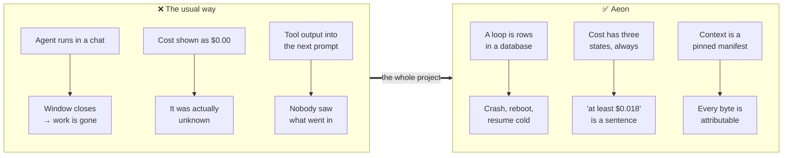
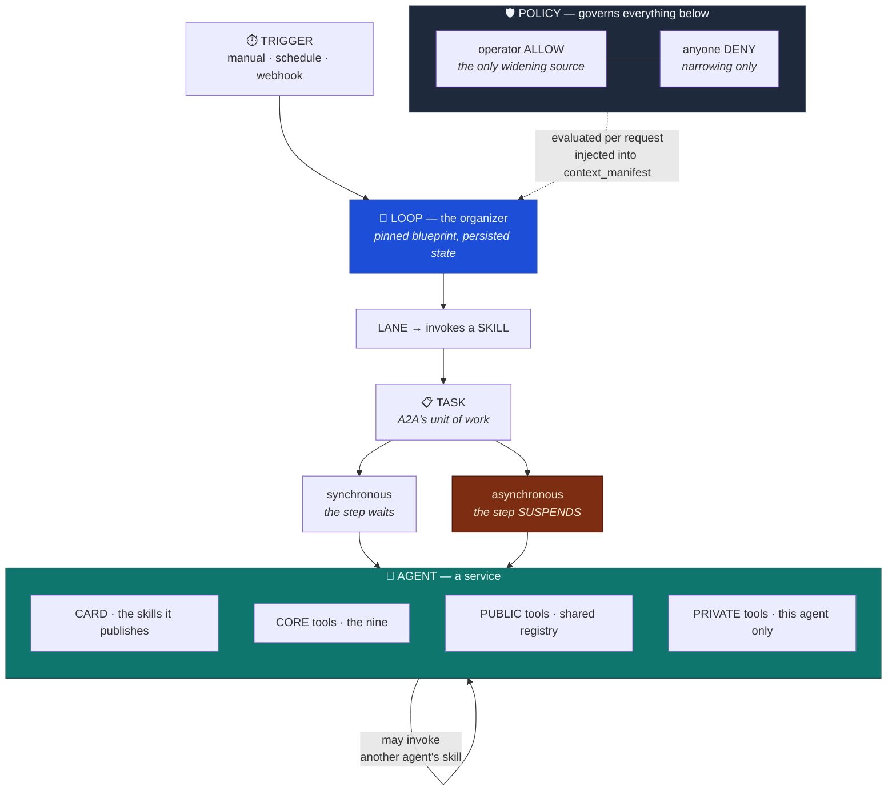
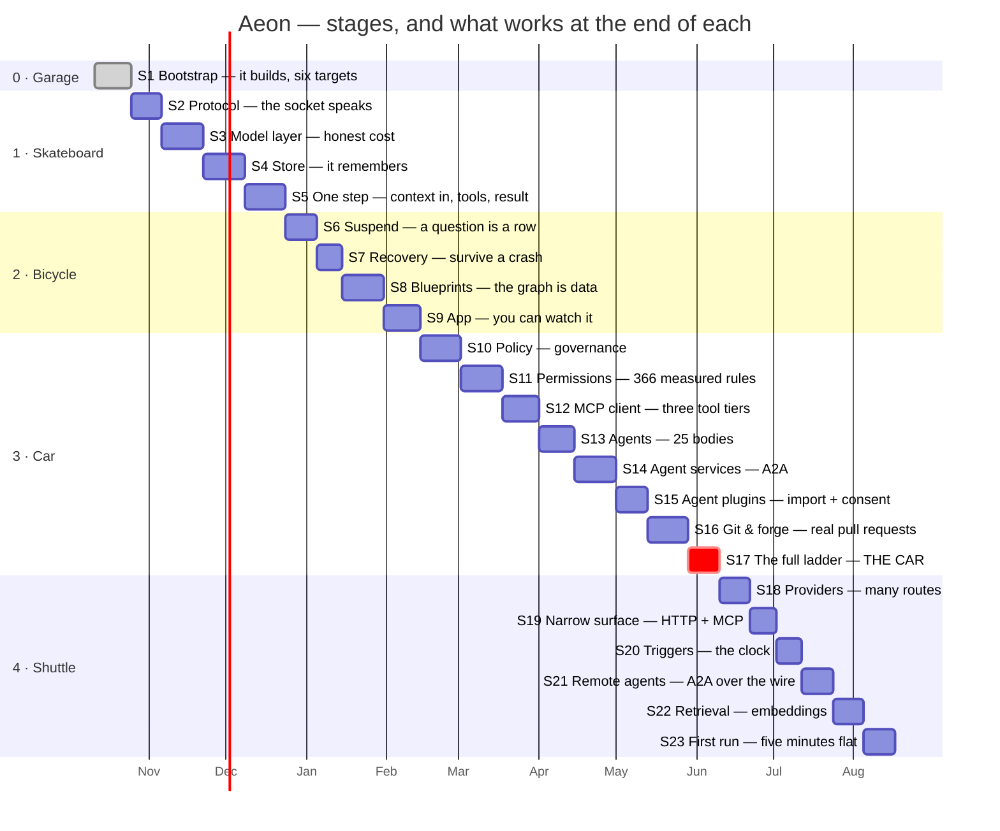
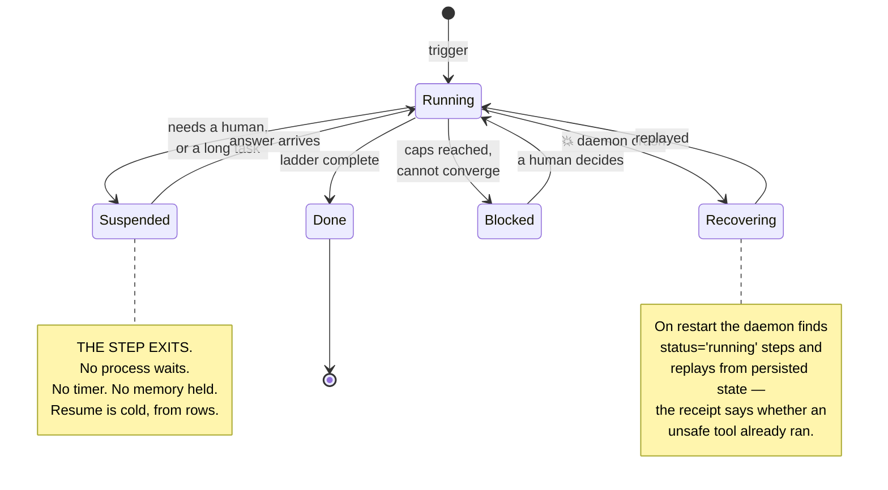
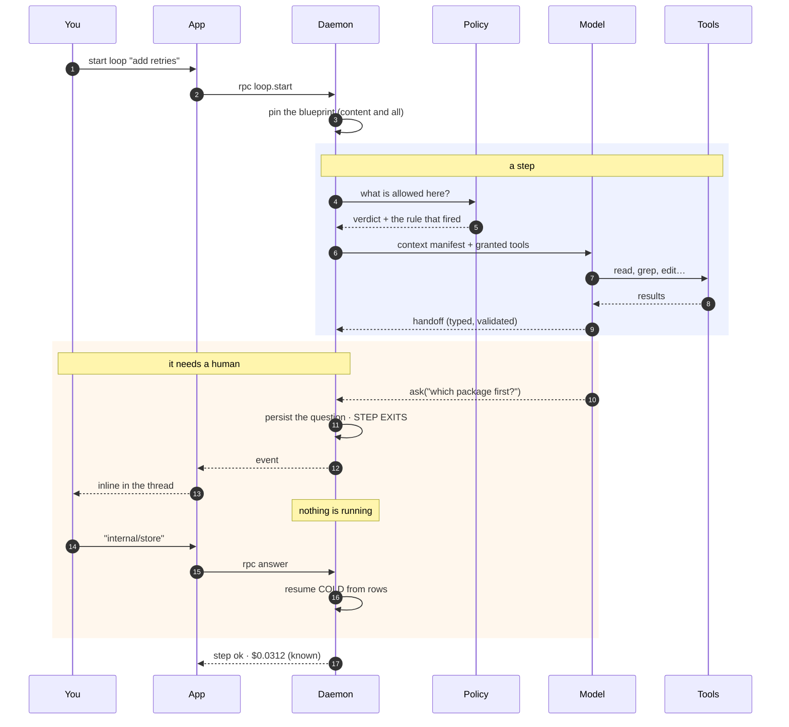
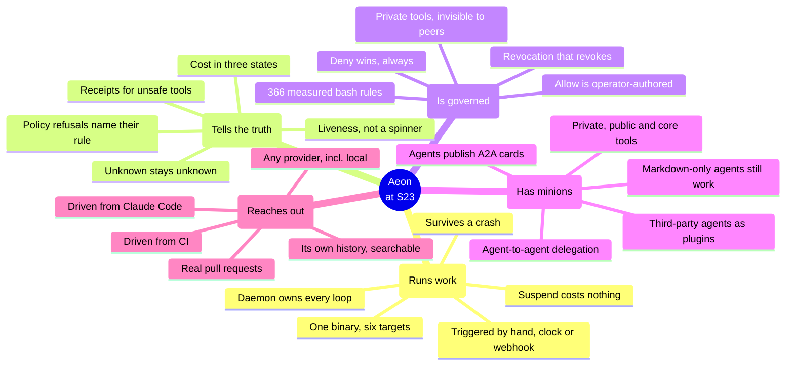
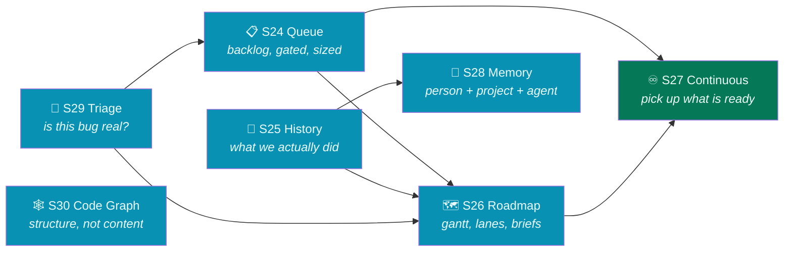

# Aeon — the vision

**A loop-native agent harness.** Not a chat window with tools bolted on, and not a framework for building
agents. A daemon that runs *long-lived, resumable units of agent work* — and a desktop app that tells you
the truth about them.

> **The one-sentence version.** Everything else in this document is detail:
>
> **Aeon makes an agent's work survivable, inspectable and honest — so you can leave it running, come back,
> and know exactly what happened and what it cost.**

| | |
| --- | --- |
| **Status** | Ground floor built and verified. 23 slices specced, 232 tasks. Building starts at S1 |
| **Plan of record** | [`ROADMAP.md`](ROADMAP.md) — this file is the picture, that one is the contract |
| **Shipping shape** | One Go binary (daemon + CLI) · a Tauri desktop app · six platform targets |

---

## 1. Why it exists

Three failures, each of which this design refuses structurally rather than mitigating.



**The thesis is uncertainty.** Four separate designs pay real cost to keep *"I cannot tell you"* a first-class
answer — cost, the `bash` receipt, blueprint validation, connection liveness. It is easy to build and easy to
lose: `unknown` becomes `—`, `—` becomes `0`, and nobody notices.

---

## 2. The shape



**Everything below the agent is optional.** An agent with no tools, no card and no skills is markdown and a
prompt — and the ladder runs on it unchanged. That is the adoption story: a company with only MCP servers
gets a working system; a company that wants more builds private tools and published skills. **Same system,
two depths.**

---

## 3. The five stages

Vertical slices. Every one ends in a `DEMO.md` — something a person runs and watches work.



> **The durations are shape, not schedule.** They are proportional to task counts, not estimates — the plan
> commits to *order and dependency*, never to dates. S17 is marked critical because it is the first slice
> where the whole protocol runs end to end.

### What you can actually do, stage by stage

| Stage | Slices | Tasks | At the end you can… |
| :---: | :--- | :---: | :--- |
| **0 · Garage** 🔧 | S1 | 7 | `make dev` → a daemon starts, prints where it lives, answers JSON-RPC over a unix socket. *Already true.* |
| **1 · Skateboard** 🛹 | S2–S5 | 44 | Ask a model something, watch it call tools in a real repository, and find the transcript byte-identical after a restart |
| **2 · Bicycle** 🚲 | S6–S9 | 40 | Start a loop, have it **ask you a question and wait** — with no process running — answer hours later, kill the daemon mid-step and watch it recover. **And see all of it in a window.** |
| **3 · Car** 🚗 | S10–S17 | 88 | Hand it a feature. It plans, builds, reviews, catches its own defect, opens **a real pull request**. Governed by policy, with agents that have their own private tools |
| **4 · Shuttle** 🚀 | S18–S23 | 53 | Run it on any provider incl. local. Drive it from Claude Code or CI. **Schedule it for 3am.** Ask *"have we decided this before?"* and get an answer from your own history |

---

## 4. The loop — the primitive everything else serves

A loop is **not a process**. It is rows, and that single choice is what makes the rest possible.



**Why this matters more than it sounds.** Because suspension is *exiting*, a loop costs nothing while it
waits. You can have a hundred suspended loops and an idle machine. And because recovery replays rows rather
than resuming memory, **a reboot is survivable** — which is the difference between "an agent I babysit" and
"an agent I delegate to".

### One step, in detail



---

## 5. What it looks like

Taken from [`S9-app/DEMO.md`](S9-app/DEMO.md) — these are the things that slice's demo asserts, not
decoration.

### The ladder, filling in as it happens

```
┌──────────────────────────────────────────────────────────────────────┐
│  ⬡ aeon        add-retries                              ● connected │
├────────────────┬─────────────────────────────────────────────────────┤
│                │  LADDER                                            │
│  ▸ LOOPS       │  ✔ clarify     done                      $0.0041   │
│    add-retries │  ✔ discovery   done                      $0.0180   │
│    fix-flaky   │  ✔ plan        done                      $0.0312   │
│    refactor-db │  ◉ build       T3 of 7  ·  golang-engineer         │
│                │  ○ verify      —                                   │
│  ▸ SYSTEM      │  ○ review      —                                   │
│    recovery    │  ○ qa          —                                   │
│    policy      │                                                    │
│    agents      │  TOTAL   at least $0.0533         ← a floor, said   │
│                │                                     as one         │
└────────────────┴─────────────────────────────────────────────────────┘
```

### The thread — a step question and a gate look identical, on purpose

```
┌ step  survey            ok      SURVEY.md      $0.0312
├ ask   "Which package should I start with?"        ← resumes a STEP
│       [ internal/store ] [ internal/runtime ] [ … ]
├ you   internal/store
├ step  survey            ok      (resumed)
├ ask   "Approve the survey and continue?"          ← advances a LOOP
│       [ approve ] [ revise ] [ abort ]
```

**Both rows render the same**, and that is deliberate. One resumes a suspended step, the other advances the
loop — and a human answering has no reason to care which. Inline in the thread, **never a modal**: a modal
detaches the decision from the context needed to make it.

### Cost, in three honest states

```
┌─────────────────────────────────────────────────────────────┐
│  known     $0.0312                                          │
│  partial   at least $0.0180        ← a floor, worded as one │
│  unknown   unknown — the provider returned no usage         │
└─────────────────────────────────────────────────────────────┘
```

**It has failed if** an unknown cost renders as `$0.00`, or `—`, or nothing. And a total over a `partial`
step must itself read as a floor — a confident total over an uncertain part is the same error one level up.

### When the socket drops, the UI goes honest

```
     connected                      disconnected
  ┌────────────────┐            ┌────────────────────────┐
  │ ● connected    │    ──▶     │ ◌ stale · 34s ago      │
  │   current      │            │   RECONNECTING…        │
  └────────────────┘            └────────────────────────┘
```

Not a spinner over stale data pretending to be live. **Three states, because a two-state UI is a UI that
lies** — and on reconnect it *re-reads* rather than resuming a stream, so it arrives at the true current
state including whatever happened while it was blind.

---

## 6. Where it ends up



### The guarantees — what is actually different

| | |
| --- | --- |
| **Suspension is exiting** | A waiting loop has no process, no timer, no held memory. Resume is cold, from rows |
| **Allow is operator-authored; deny may be authored by anyone; deny wins** | This is what makes third-party agents and MCP servers safe *without trusting them* — nothing they carry can widen anything |
| **Private tools are invisible, not merely unauthorized** | A peer that cannot see a tool cannot try. That *dissolves* transitive capability escalation rather than mitigating it |
| **The policy corpus is extracted, never transcribed** | 366 `bash` rules come from the real agent definitions at build time, so they cannot drift from what they govern |
| **A blueprint is pinned per loop, content and all** | Editing a blueprint cannot change a loop already running on it |
| **Nothing spawns** | No process tree, so no orphans and no abort semantics to get wrong. Delegation is a recorded graph, and cost rolls up along it |
| **The store is truth; files are a disposable mirror** | Anything rendered is regenerable |

---

## 7. Beyond the alpha

No longer a bare sketch anywhere in this stage, and only one slice stopped at brief depth. **S27 stopped
there on purpose despite being askable to go further** — its own sketch called itself "the largest change to
the daemon's model in the whole plan," and that self-assessment still held when asked directly, so its brief
resolves what it can against the now-real S24/S25/S26 (S26's `D4` "ready" definition, used verbatim; S16's
D8 on effect classes, quoted) and names the rest plainly rather than guessing: a real loop-level stop/cancel
does not exist yet, and S26's `roadmap_item` will need an `attended` column S26 does not carry today.
**S24, S25, S26, S28, S29 and S30 go further still**: all six are specced all the way through to task files
— S24's `design.md` resolved its own open questions against S11/S12/S13, now that those are built; S25's
resolved the one its 2026-09-07 sketch could not have had (S4's archive tables, found while reading the
real schema); S26's corrected the sketch's own assumption about how ideation works (`S8-blueprints/
design.md`'s GAP-7: a chat with tools, not a new blueprint shape) and reuses S25's Gantt component outright
for its forward view; S28's found two corrections of its own (its code is `internal/learnings`, not
`internal/memory` — already S20's, a different mechanism — and agent scope is a Go-level check, not a SQL
foreign key, since S13's built-in bodies have no row to reference); **S29's own Q2 turned out to already be
answered by D2** (validation and priority were always two separate fields, the question's own phrasing had
half-assumed otherwise), and its hand-off targets S26 only, through S26's ordinary `idea` status, needing
zero changes to S26. **S26 is the one of the six that cannot actually be built yet at all** — its own code
depends on S24's and S25's, and **S27 sits one layer further out than that**, needing S26 built too. **S28
is fully buildable now** — its message-board task (T7) waited on S14, which landed 2026-10-26; T6/T7 are
re-checked against S14's real API. **S29 carries a narrower block**: most of its tasks are free to build
today; T5/T6 each wait on a sibling slice's real code (S28's learnings core, S26's core) rather than an
unbuilt slice's spec. S30, unlike the others, was never one of
this stage's original sketches; it is a new addition. **A seventh slice, S33 Telemetry, sits just outside
this diagram** — not part of the queue/history/roadmap/memory/triage/graph/continuous cluster below, but the
thing that fills the gap S25 deliberately declined to carry: see
[`S33-telemetry/brief.md`](S33-telemetry/brief.md).



**Queue comes first of all** — one project, one ordered backlog, advancing on its own unless the project asks to
be consulted first. **History comes first of the rest**, which reverses how it was raised. It is useful *alone* —
*"what has this thing actually done for me"* — and it is what makes the roadmap adoptable at any point. That
requirement shapes the other four: **a project can start feature-by-feature and gain a roadmap in month six.** So
the roadmap can never be the source of truth for what happened; it is a view over loops — and, where one exists,
a queue — that already exist.

**S29 Triage is the differentiator, and now fully planned.** *Fixing* a bug is the ladder with a different
entry point; *validating* one is mostly a one-step loop with a different prompt — both already exist.
**Triage — is this real, is it a duplicate, what priority — is what was genuinely missing**, and it needs
`could-not-tell` as a first-class verdict, because in practice that is the majority — plus a fourth,
pre-attempt `unvalidated` state, so "nobody has looked yet" never reads as "somebody looked and couldn't
tell." Unlike S24's queue, a validation attempt dispatches with no project gate at all — G14's existing
unattended-denies-outward rule already bounds what it could do, so there is nothing a gate would add. It
schedules nothing itself: a validated, prioritized bug hands off to **S26's roadmap only** — never S24
directly, since S26 already knows how to reach S24's queue when one exists.

**S30 Code Graph draws with no edges into the rest of this diagram, deliberately** — it does not feed or
depend on any of the other six. Its one real connection is outside this stage entirely — a shared,
unresolved question with S22 (Stage 4) about how a loop signals that it wrote a file, answered once and
used by whichever of the two slices needs it first.

**S24 Queue, S25 History, S26 Roadmap, S28 Memory and S29 Triage share S30's cyan, but not its isolation.**
All six now have a full `design.md`, `plan.md` and task files rather than a brief alone (**S27 is the one
green, brief-only node left**) — but S24, S25, S26, S28 and S29 keep their edges, because unlike S30 all
five are meant to be built on: S26 renders S24's ordering and S25's record, drawn here as the edges
`S24 → S26` and `S25 → S26`; S29 feeds S24 and S26, drawn as `S29 → S24` and `S29 → S26` (**correction**:
an earlier pass here said the first of those two was the accurate one — backwards. The hand-off targets
S26 only, not S24 directly, so `S29 → S26` is the edge that matches this slice's actual design; `S29 →
S24` is the one closer to history than to the design as it now stands; left as drawn, named here). **S26
is the one slice on this diagram that cannot be built yet at all despite being fully specced** — its own
code imports S25's component and calls S24's queue directly. **S28 is fully buildable now** (S14 landed
2026-10-26; T6/T7 re-checked against its real API) — the cyan here no longer carries an asterisk for it.
**S29 carries a narrower block that does not show on this diagram at the node level**: cyan here still
reads "planned," but most of its tasks are actually buildable today — T5 and T6 each wait on a sibling
slice's real code rather than an unbuilt slice's spec.
**The edge `S25 → S28` is looser than the others
and worth flagging rather than silently endorsing**: drawn before S28 had a real brief, and
`S28-memory/design.md` still names no real dependency on S25 — `S28-memory/brief.md` says plainly *"none of
this slice's dependencies run through [S25]"*, citing it only as an analogy (the same "not a second source
of truth" reasoning), not a data dependency, and nothing in the slice's later `design.md` changed that. Left
on the diagram as drawn, since redrawing Stage 5's shape is outside this session's scope, but named here so
a reader does not take it as confirmed. Cyan here means "further along," not
"self-contained" — that second property is S30's alone.

---

> **Right now Aeon runs a loop. With Stage 5 it runs a project.**
